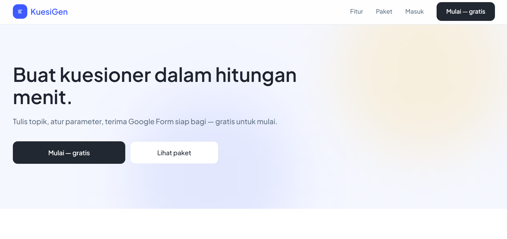

# KuesiGen

**KuesiGen** adalah aplikasi web untuk membuat kuesioner riset dalam hitungan menit. Tulis topik (maks 200 kata), atur parameter, terima draf pertanyaan dari AI, lalu terbitkan sebagai **Google Form asli** di Google Drive Anda — siap dibagikan.



> **Status:** Jalur pengguna sudah lengkap — masuk Google, generate kuesioner, terbit ke Google Drive, riwayat. Panel admin sudah operasional dengan data nyata (pengguna, kuesioner, laporan, kuota LLM, galeri banner, analitik, pemakaian harian, pengaturan paket). Sisa: pengisian penyedia model lewat `/admin/penyedia` dan aktivasi Google Forms API + Drive API di Google Cloud Console.

---

## Tentang Produk

KuesiGen memangkas tiga langkah paling lambat saat menyusun instrumen penelitian: **menulis butir pertanyaan**, **memilih tipe jawaban**, dan **menerbitkan form**. Pengguna cukup mengetik topik, meninjau draf, lalu menerbitkannya ke Google Drive mereka.

### Tiga Jenis Pengguna

| Peran | Deskripsi |
|-------|-----------|
| **Mahasiswa (Free)** | Butuh draf cepat tanpa variabel penelitian. Kuesioner selalu jenis **Umum → Bebas**. Batas: 5 kuesioner/bulan, 20/hari, max 15 pertanyaan. |
| **Mahasiswa (Premium)** | Butuh instrumen mengikuti variabel penelitian (bebas X1–Xn, terikat Y1–Yn). Pilih **Umum** (Bebas/Kuantitatif/Kualitatif) atau **Akademis** (Kuantitatif/Kualitatif). Profil pembuat untuk surat pembuka. Kuesioner & pertanyaan tanpa batas bulanan (harian tetap 20). Contoh data responden (`.xlsx` untuk SPSS/SmartPLS). Prioritas antrean generate. Harga awal Rp20.000/bln (disesuaikan admin). |
| **Admin Internal** | Panel operasional desktop: ringkasan, pengguna, kuesioner, laporan, kuota API & LLM, galeri banner, analitik, pemakaian harian, pengaturan, paket. Masuk email + kata sandi, hanya desktop. |

**Nuansa visual:** Tenang, akademik-modern, terpercaya. Biru kepercayaan (`#3D5AFE`) sebagai aksen brand, latar netral sejuk (`#F5F7FF`), emas hangat (`#FFCB56`) ketat untuk Premium. Tema terang saja.

---

## Fitur Utama

### Area Pengguna (Next.js App Router → Laravel Routes)

| Halaman | Deskripsi |
|---------|-----------|
| **Beranda** (`/`) | Hero dua kolom: salinan produk kiri, pratinjau alur kanan. Manfaat, FAQ akordeon, ringkasan paket (tanpa harga), CTA "Mulai gratis" & "Lihat paket". |
| **Kebijakan Privasi & Syarat Ketentuan** | `/kebijakan-privasi`, `/syarat-ketentuan` — publik, dipakai untuk verifikasi OAuth Google. |
| **Masuk** (`/masuk`) | Tombol Google OAuth (state bertanda tangan, penukaran code, sesi cookie, redirect ke dasbor). Kegagalan kembali ke halaman ini sebagai pesan. |
| **Dasbor** (`/dasbor`) | Sapaan, kartu kuota bulanan (sisa Free / terpakai Premium + sisa harian), tombol "Buat Kuesioner Baru", daftar kuesioner terakhir. |
| **Buat Kuesioner** (wizard) | **Pilihan instrumen → Jenis → Topik → Variabel → Profil pembuat → Proses → Pratinjau**. Instrumen menentukan jenis jawaban & apakah langkah variabel muncul (hanya kuantitatif). Topik max 200 kata. Variabel & profil = Premium. Validasi anggaran pertanyaan per variabel. Penolakan di luar lingkup (kode, esai, target orang) → "Topik Di Luar Lingkup" tanpa memakai kuota. |
| **Surat Pembuka & Instrumen** | Ditulis model sesuai peran pembuat. Demografi di seksi pertama (Akademis: + kriteria responden & pernyataan kesediaan). Pertanyaan dikelompokkan per variabel (kuantitatif). Perkiraan waktu dihitung aplikasi, bukan model. |
| **Proses** | Indikator berjalan (Server Action). Tidak ada timer/tahap rekaan. Gagal → tombol kontekstual: "Coba lagi", "Ganti topik", "Perbaiki isian". Batal sengaja tidak ada (request sudah terkirim). |
| **Pratinjau** | Ringkasan topik, jumlah pertanyaan, surat pembuka, bagian instrumen, variabel. |
| **Hasil** | Kotak tautan Google Form (ikon salin menempel), aksi "Terbitkan ke Drive"/"Buka Google Form" & "Contoh data responden" (Premium: 10–200 kelipatan 10, `.xlsx` siap SPSS/SmartPLS). Banner opsional (galeri admin / unggah sendiri, JPG/PNG ≤3 MB). Terbit ulang tanpa modal. |
| **Riwayat** (`/riwayat`) | Daftar draf: judul, jumlah pertanyaan, status (Draf/Siap dibagikan/Terbit), waktu update. Keadaan kosong informatif. |
| **Paket & Harga** (`/paket`) | Perbandingan Free vs Premium, tombol "Upgrade lewat WhatsApp" (ke `0831-6928-6490`). Pembayaran manual lewat admin. Pengguna Premium dikembalikan ke Dasbor. |
| **Pengaturan** (`/pengaturan`) | Profil (nama, avatar crop 1:1 → 512×512 JPEG), koneksi Google Drive/Forms, notifikasi, laporan, keluar. |
| **Laporan & Masukan** (`/laporan`) | Textarea bebas (bug, fitur, pertanyaan, klarifikasi). Limit 5/jam/user. Nama & email dari sesi. |

### Panel Admin (Desktop Only → `/admin/*`)

| Halaman | Deskripsi |
|---------|-----------|
| **Masuk Admin** (`/admin/masuk`) | Email + kata sandi. Shell: top bar (logo, judul, notifikasi, avatar) + sidebar 264px kategori (UTAMA, PENGGUNA, KUESIONER, SISTEM, STATISTIK). Hanya desktop — mobile menampilkan pemberitahuan. Shell `h-screen overflow-hidden`, hanya `<main>` yang bergulir. |
| **Ringkasan** | Total pengguna (bukan admin), kuesioner terbit, permintaan LLM, token bulan ini + daftar kuesioner terbaru. |
| **Pengguna** | Daftar + pencarian, paket + masa berlaku, jumlah kuesioner, terakhir aktif. Ekspor CSV (max 100 baris). Aksi: Aktifkan/Atur Premium (Selamanya / Sampai tanggal WIB), nonaktifkan (konfirmasi), turun ke Free otomatis lewat tanggal. Akun admin tidak tampil. |
| **Kuesioner** | Semua kuesioner lintas pemilik: status (Draf/Siap dibagikan/Terbit), pemilik. |
| **Laporan** | Tab Semua / Menunggu / Ditindaklanjuti. Aksi "Tinjau" → status resolved + catatan resolusi. |
| **Kuota API & LLM** | Pemakaian bulan ini, sisa kuota paket, daftar penyedia LLM + terakhir pakai. CRUD penyedia (tes, ubah nama/model/endpoint/batas menit/kunci API via dialog, aktif/nonaktif, hapus). Kunci tersimpan terenkripsi, rotasi per menit. |
| **Galeri Banner** | Unggah JPG/PNG ≤3 MB, atur status aktif, lihat ukuran, aktif/nonaktif/hapus. Hanya galeri admin (banner personal user tidak tampil di sini). |
| **Analitik Penggunaan** | Generate, pengguna aktif, token LLM, Forms dibuat. Grafik harian, komposisi paket, fitur populer. Waktu WIB. |
| **Pemakaian Harian** (`/admin/harian`) | Generate hari ini: jumlah, distribusi per jam (WIB), pemakaian per user vs batas harian, penanda penuh. Baca dari `daily_usage` (sama yg blokir generate). |
| **Pengaturan** | Zona waktu operasional (`Asia/Jakarta`), penyedia aktif. |
| **Paket & Harga** | Editor harga, kuota bulanan, batas kuesioner/hari, batas pertanyaan, izin fitur, sakelar "pilihan jenis kuesioner" (kuantitatif/kualitatif). Dibaca database, bukan hardcode. |

---

## Tech Stack (Laravel Implementation)

| Layer | Teknologi |
|-------|-----------|
| **Framework** | Laravel 13.x (PHP 8.3+) |
| **Frontend** | Vite 8, Tailwind CSS v4, laravel-vite-plugin |
| **Database** | SQLite (dev) / PostgreSQL (prod) |
| **Auth** | Laravel Socialite (Google OAuth) + JWT sesi (cookie httpOnly) |
| **Storage** | Cloudinary (banner & avatar) |
| **Excel Export** | `maatwebsite/excel` atau `box/spout` (contoh data responden `.xlsx`) |
| **Queue/Jobs** | Cron job penurunan paket (`plan-expiry`) + email Resend |
| **Font** | Plus Jakarta Sans (Bunny Fonts) |
| **Icons** | Lucide (Blade components) + SVG merek |
| **Animasi** | CSS `@keyframes` (slide-up 300ms, stagger 60ms, reduced-motion) |
| **Lint/Format** | Laravel Pint (PHP), ESLint + Prettier (JS/CSS) |
| **Git Hooks** | Husky + lint-staged |

> **Catatan:** Implementasi asli pakai **Next.js 16 (App Router) + TypeScript + React 19**. Repo Laravel ini adalah *mirror* untuk keperluan presentasi/demo — logika bisnis, skema DB, dan alur identik.

---

## Struktur Proyek (Laravel)

```
kuesigen/
├── app/
│   ├── Http/
│   │   ├── Controllers/
│   │   │   ├── Auth/           # Google OAuth, session, admin login
│   │   │   ├── User/           # Dashboard, Questionnaire wizard, History, Settings, Report
│   │   │   └── Admin/          # Admin panel controllers
│   │   ├── Middleware/         # Role guard, session verification, proxy
│   │   └── Requests/           # Form requests (validation)
│   ├── Models/                 # User, Questionnaire, Plan, LLMProvider, Banner, Report, DailyUsage, Audit
│   ├── Services/               # Domain logic: Auth, Questionnaire, Plan, Admin, Media, LLM, Report
│   ├── Actions/                # Server Actions equiv: GenerateQuestionnaire, PublishToDrive, SetUserPlan, etc.
│   └── Helpers/                # plan.ts, contact.ts, adminRoute.ts, toast.ts, user.ts, datetime.ts
├── database/
│   ├── migrations/             # Schema: users, questionnaires, plans, plan_features, llm_providers, banners, reports, daily_usage, audits
│   ├── seeders/                # Plan seeder (Free/Premium initial)
│   └── schema.sql              # Referensi PostgreSQL (source of truth)
├── resources/
│   ├── views/
│   │   ├── layouts/            # app.blade.php, admin.blade.php, guest.blade.php
│   │   ├── user/               # dashboard, questionnaire wizard, history, settings, report, plans
│   │   ├── admin/              # admin panel pages
│   │   ├── auth/               # login, register (Google)
│   │   ├── components/         # Blade components (Button, Input, Modal, Toast, Badge, Card, StatCard, etc.)
│   │   └── welcome.blade.php   # Landing page (hero, fitur, paket, CTA, footer)
│   ├── css/
│   │   ├── app.css             # @tailwind + @theme (tokens dari PROJECT.md)
│   │   └── landing.css         # @reference app.css + komponen landing
│   └── js/app.js               # Alpine.js / vanilla: mobile nav, toast, modal, avatar crop
├── routes/
│   ├── web.php                 # User routes (/, /masuk, /dasbor, /kuesioner/*, /riwayat, /paket, /pengaturan, /laporan)
│   ├── admin.php               # Admin routes (/admin/*)
│   └── auth.php                # Google OAuth routes
├── config/
│   ├── env.php                 # Env validation (required vars, length checks)
│   ├── plans.php               # Plan features map (dibaca dari DB, fallback ke config)
│   └── services.php            # Google, Cloudinary, Resend
├── public/
│   ├── icons/kuesigen.svg      # Logo merek (JSX di Next.js → SVG di Blade)
│   └── build/                  # Vite output (manifest.json, assets)
├── docs/
│   └── landing_page.png        # Screenshot landing page
├── storage/
│   └── app/                    # Temporary files
├── tests/
│   ├── Feature/                # HTTP tests (user flow, admin, auth)
│   └── Unit/                   # Service/Action tests
├── vite.config.js              # Vite + laravel-vite-plugin + @tailwindcss/vite
├── composer.json
├── package.json
├── .env.example
└── README.md
```

---

## Design System (dari `PROJECT.md` & Figma)

### Palet Warna (Tailwind `@theme`)

| Token | Hex | Peran |
|-------|-----|-------|
| `--color-primer` | `#3D5AFE` | Brand aksen: logo, tautan, nav aktif, tombol primer modal |
| `--color-primer-cerah` | `#4A6FFF` | Hover primer |
| `--color-generate` | `#222831` | Tombol aksi utama alur (Mulai, Generate) |
| `--color-premium` | `#FFCB56` | Premium: kartu, badge, tombol upgrade |
| `--color-teks` | `#1E2430` | Teks utama |
| `--color-latar` | `#F5F7FF` | Latar halaman |
| `--color-permukaan` | `#FFFFFF` | Kartu, modal |
| `--color-teks-sekunder` | `#607183` | Teks sekunder, nav pasif |
| `--color-garis` | `#D7E1E8` | Border |
| `--color-nonaktif-latar` | `#E2E8F0` | Hover non-aktif |
| `--color-sukses-teks` | `#15803D` | Sukses teks |
| `--color-sukses-garis` | `#BBF7D0` | Sukses border |
| `--color-galat-teks` | `#B91C1C` | Galat teks |
| `--color-galat-garis` | `#FECACA` | Galat border |

### Radius

| Token | Nilai | Peran |
|-------|-------|-------|
| `--radius-kartu` | `14px` | Kartu, kontainer |
| `--radius-tombol` | `12px` | Tombol |
| `--radius-pil` | `16px` | Badge/lencana |
| `--radius-modal` | `16px` | Modal |

### Tipografi

- **Font:** Plus Jakarta Sans (Bold, SemiBold, Medium)
- **Wordmark "KuesiGen":** Extrabold (800), "Kuesi" `#3D5AFE` + "Gen" `#2B4993`
- **Skala utama:** Hero 48/28, Judul halaman 34, Harga 40, Kartu besar 24, Modal 20, Seksi 18, Body/Tombol 16, UI/Nav 15, Caption 13, Sidebar label 12 ALL CAPS, StatCard 22 Bold

### Motion

- **Enter:** 300ms (fade + naik 12px)
- **Stagger:** 60ms antar elemen
- **Hover/Tap:** 150ms
- **Toast auto-close:** 4500ms
- **Reduced-motion:** fade only, no transform

---

## Prasyarat

- PHP ≥ 8.3
- Composer
- Node.js ≥ 18 & npm
- SQLite (dev) / PostgreSQL ≥ 15 (prod)
- Google Cloud Console project (OAuth client ID + secret)
- Cloudinary account (banner & avatar)
- Resend account (email transaksional, opsional)

---

## Quick Start (Development)

```bash
# Clone repository
git clone <repository-url>
cd kuesigen

# Install dependencies
composer install
npm install

# Setup environment
cp .env.example .env
php artisan key:generate

# Edit .env dengan kredensial Anda:
# APP_URL=http://localhost:8000
# DB_CONNECTION=sqlite (atau pgsql untuk prod)
# GOOGLE_CLIENT_ID=...
# GOOGLE_CLIENT_SECRET=...
# GOOGLE_REDIRECT_URI=http://localhost:8000/auth/google/callback
# CLOUDINARY_CLOUD_NAME=...
# CLOUDINARY_API_KEY=...
# CLOUDINARY_API_SECRET=...
# JWT_SECRET= (generate: php artisan kuesigen:generate-jwt)
# TOKEN_ENCRYPTION_KEY= (generate: php artisan kuesigen:generate-encryption)

# Database & migrasi
php artisan migrate --seed

# Build assets (dev)
npm run dev

# Jalankan server (PHP + Vite HMR)
composer dev
# atau manual:
# php artisan serve
# npm run dev (terminal terpisah)
```

Akses: `http://localhost:8000` (Beranda) → `/masuk` (Google OAuth) → `/dasbor`

---

## Environment Variables (`.env.example`)

| Variabel | Wajib | Keterangan |
|----------|:---:|------------|
| `APP_URL` | ya | URL publik absolut |
| `DB_CONNECTION` | ya | `sqlite` / `pgsql` |
| `DATABASE_URL` | pgsql | Connection string PostgreSQL |
| `JWT_SECRET` | ya | ≥32 char acak (generator: `php artisan kuesigen:generate-jwt`) |
| `TOKEN_ENCRYPTION_KEY` | ya | Base64 32 byte (generator: `php artisan kuesigen:generate-encryption`) |
| `GOOGLE_CLIENT_ID` | ya | OAuth client ID |
| `GOOGLE_CLIENT_SECRET` | ya | OAuth client secret |
| `GOOGLE_REDIRECT_URI` | ya | `${APP_URL}/auth/google/callback` |
| `CLOUDINARY_CLOUD_NAME` | ya | Nama cloud |
| `CLOUDINARY_API_KEY` | ya | API key |
| `CLOUDINARY_API_SECRET` | ya | API secret |
| `CLOUDINARY_ROOT_FOLDER` | tidak | Default `kuesigen` |
| `RESEND_API_KEY` | tidak | Email transaksional (tanpa ini email tidak terkirim) |
| `EMAIL_FROM` | tidak | Default `KuesiGen <noreply@kuesigen.site>` |
| `EMAIL_REPLY_TO` | tidak | Alamat balasan |
| `CRON_SECRET` | tidak | Rahasia cron job penurunan paket |
| `TRUSTED_PROXY_HOPS` | tidak | Jumlah proxy tepercaya (default `1`) |

> **Catatan:** Batas paket (kuota, harga, izin fitur) **tidak** di env — kelola lewat panel admin `/admin/paket` (tersimpan di tabel `plans` & `plan_features`). Kunci API LLM & nama model juga di DB (tabel `llm_providers`, terenkripsi).

---

## Google Cloud Console Setup (Wajib untuk Publikasi)

1. **Aktifkan API** di *APIs & Services → Library*: **Google Forms API** & **Google Drive API**.
2. **Tambahkan scope** di *OAuth consent screen → Data access*: hanya `https://www.googleapis.com/auth/drive.file`.
3. **Daftarkan redirect URI**: `${APP_URL}/auth/google/callback` (sama untuk login & izin Drive).
4. Saat status **Testing**, tambahkan akun penguji di *Test users*.

Tanpa langkah 1–2, alur "Hubungkan Drive" gagal (`?drive=gagal`). Login Google tetap jalan (hanya `openid email profile`).

---

## Perintah Berguna

```bash
# Development
composer dev              # PHP serve + Vite HMR
npm run dev               # Vite dev server
npm run build             # Build production assets (public/build/)

# Database
php artisan migrate       # Jalankan migrasi
php artisan migrate:fresh # Reset & migrasi ulang (destruktif)
php artisan db:seed       # Seed plan Free/Premium

# Testing
php artisan test          # PHPUnit (clear config dulu)
composer test             # Alias di composer.json

# Keys & Secrets
php artisan kuesigen:generate-jwt          # JWT_SECRET (48 byte base64)
php artisan kuesigen:generate-encryption   # TOKEN_ENCRYPTION_KEY (32 byte base64)
php artisan kuesigen:generate-secret       # Rahasia bebas (hex/base64, panjang custom)

# Admin (CLI only, tidak dari UI)
php artisan kuesigen:admin:create --email=admin@domain.com --password=rahasia123
php artisan kuesigen:admin:delete --email=admin@domain.com
# Flag --prod untuk database produksi (baca .env.production.local → .env.production → .env)

# Cron (jadwalkan di server: harian 00:00 WIB)
php artisan schedule:run  # Menjalankan job plan-expiry (turunkan paket + email)
```

---

## Alur Bisnis Inti (Ringkas)

### Pembuatan Kuesioner
1. **Pilih Instrumen** → Umum (Angket/Acara/Minat) atau Akademis (Penelitian)
2. **Pilih Jenis** → Umum: Bebas/Kuantitatif/Kualitatif | Akademis: Kuantitatif/Kualitatif (Premium)
3. **Tulis Topik** (≤200 kata) + **Jumlah Pertanyaan** (kuantitatif = anggaran pembagian variabel)
4. **Variabel** (Premium) → Bebas X1–Xn, Terikat Y1–Yn, nama masing-masing. Bagi rata otomatis.
5. **Profil Pembuat** (Premium, opsional) → Peran (Mahasiswa/Dosen/Peneliti/Umum) + field per peran → konteks surat pembuka.
6. **Proses** → Server Action generate (tanpa timer). Gagal → tombol kontekstual. Penolakan di luar lingkup → tidak makan kuota.
7. **Pratinjau** → Ringkasan, surat, bagian, variabel.
8. **Hasil** → Tautan Google Form (salin), **Terbitkan ke Drive** (modal 5 detik pertama kali), **Contoh Data Responden** (Premium, `.xlsx`).
9. **Banner Opsional** → Pilih galeri admin / unggah sendiri (≤3 MB, JPG/PNG) sebelum terbit.

### Batas Paket
| | Free | Premium |
|---|------|---------|
| Kuesioner/bulan | 5 | Unlimited |
| Kuesioner/hari | 20 (kedua paket) | 20 |
| Pertanyaan/kuesioner | Max 15 | Unlimited |
| Instrumen | Umum → Bebas | Umum (Bebas/Kuantitatif/Kualitatif) + Akademis (Kuantitatif/Kualitatif) |
| Variabel penelitian | ❌ | ✅ (X1–Xn, Y1–Yn) |
| Profil pembuat | ❌ | ✅ |
| Contoh data responden | ❌ | ✅ (`.xlsx`) |
| Prioritas antrean | ❌ | ✅ |
| Harga | Gratis | Rp20.000/bln (awal, disesuaikan admin) |

> Batas harian 20 adalah pagar anti-penyalahgunaan — Premium juga kena. Tidak ditampilkan di UI (hanya kuota bulanan). Dikenakan di `services/generation.ts` (Next.js) / `Actions/GenerateQuestionnaire.php` (Laravel).

### Berlangganan
- **Tidak ada payment gateway.** Tombol upgrade → WhatsApp pemilik (`0831-6928-6490`).
- Admin aktifkan Premium lewat `/admin/pengguna` → dialog "Aktifkan/Atur Premium" (Selamanya / Sampai tanggal WIB).
- Penurunan otomatis lewat cron `plan-expiry` (harian 00:00 WIB) + email Resend.

### Email Transaksional (Resend)
1. Aktivasi/perpanjangan → "Terima kasih telah berlangganan Premium"
2. Penghentian admin → "Langganan Premium dihentikan"
3. Masa lewat (cron) → "Masa Premium telah berakhir" (turun ke Free dulu, baru kirim email)
4. Payment gateway → template siap (`templates/subscriptionPayment`), belum dipakai.

---

## Deployment (Produksi)

Target: **Vercel** (Next.js asli) / **VPS + Nginx + PHP-FPM** (Laravel).

### Laravel ke VPS
1. Server: Ubuntu 24.04, PHP 8.3 + extensions (pdo_pgsql, gd, zip, bcmath, intl), Nginx, PostgreSQL 16, Node 20+, Redis (queue).
2. Clone repo, `composer install --optimize-autoloader --no-dev`, `npm run build`.
3. `.env` production: `APP_ENV=production`, `APP_DEBUG=false`, `APP_URL=https://kuesigen.site`, `DB_CONNECTION=pgsql`, `DATABASE_URL=...`, secrets dari generator.
4. Migrasi: `php artisan migrate --force` (pakai flag `--prod` di script custom).
5. Nginx: root ke `public/`, PHP-FPM socket, gzip, cache static assets (`public/build`).
6. Queue worker: `php artisan queue:work --sleep=3 --tries=3` (supervisor/systemd).
7. Scheduler: `* * * * * cd /path && php artisan schedule:run >> /dev/null 2>&1` (cron harian plan-expiry).
8. HTTPS: Certbot (Let's Encrypt) + HSTS.
9. Header keamanan: `X-Frame-Options`, `X-Content-Type-Options`, `Referrer-Policy`, `Permissions-Policy`, `Cross-Origin-Resource-Policy`, `Origin-Agent-Cluster`, `X-Permitted-Cross-Domain-Policies`, `X-Robots-Tag` untuk area privat.

> Detail lengkap: `DEPLOYMENT.md` (repo Next.js asli).

---

## Keamanan & Privasi

- **Enkripsi:** Token Google Drive/Forms AES-256-GCM (`TOKEN_ENCRYPTION_KEY` 32 byte). JWT HS256 (`JWT_SECRET` ≥32 char).
- **Scope OAuth:** Login hanya `openid email profile`. Drive/Forms scope diminta terpisah saat user klik "Hubungkan Drive".
- **Cookie Sesi:** `httpOnly`, `secure` (prod), `sameSite=lax`, hanya `id` & `role`. Paket & status Drive diresolusi ulang per request.
- **Rate Limit:** Login, generate, upload avatar/banner, laporan (5/jam), admin actions.
- **Admin Guard:** Role `admin` dari DB (bukan token). Dua arah: user tidak bisa buka `/admin/*`, admin dibawa ke `/admin/*` padanan.
- **Penonaktifan Akun:** Soft delete (`is_active=false`), sesi dicabut, data utuh, bisa dipulihkan.
- **Headers:** `X-Powered-By` dihapus, CSP ketat, `productionBrowserSourceMaps: false`.

---

## Aksesibilitas

- Semantik HTML5 (`<header>`, `<main>`, `<section>`, `<footer>`, `<nav>`, `<article>`).
- Label eksplisit pada input, `aria-describedby` untuk pesan galat.
- Fokus visible (`focus-visible:outline-2`), skip link.
- `prefers-reduced-motion`: animasi slide-up dinonaktifkan, hanya fade.
- Kontras teks ≥4.5:1 (AA), teks besar ≥3:1. Border input tidak jadi penanda tunggal (label wajib).
- Status tidak hanya warna: badge + ikon + label.

---

## Lisensi

MIT License — lihat [LICENSE](LICENSE) untuk detail.

---

## Tim Pengembang

| Nama | Peran |
|------|-------|
| **Aang Solihin** | Project Lead / Fullstack Developer |
| **Fathen Ayala Delpiero** | Backend Developer |
| **Ilham Septian** | Frontend Developer |
| **M. Ilham Nurhakim** | System Analyst |
| **Wisnu Rifki Wijaya** | QA Engineer |